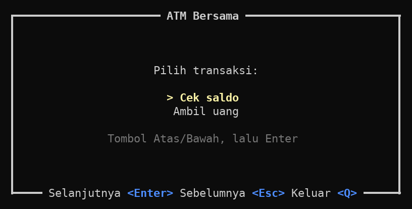
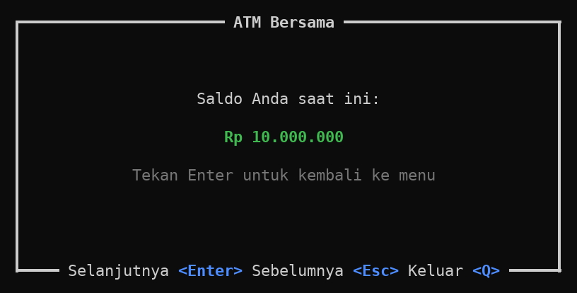
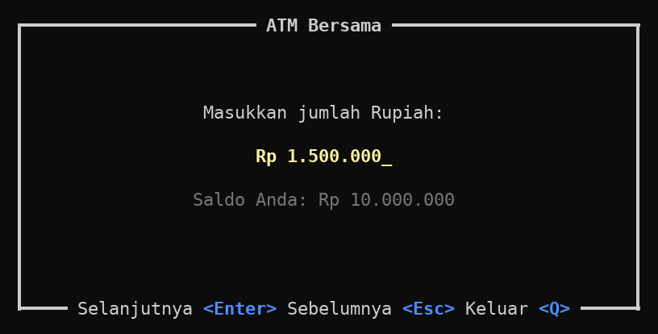
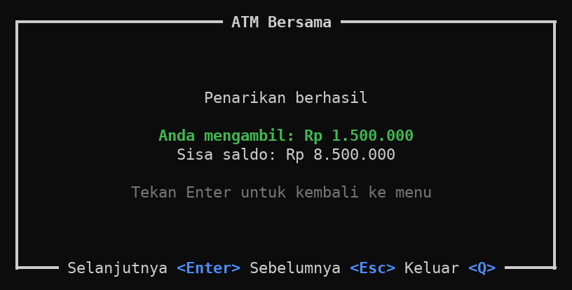
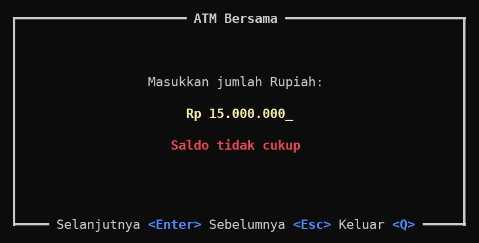
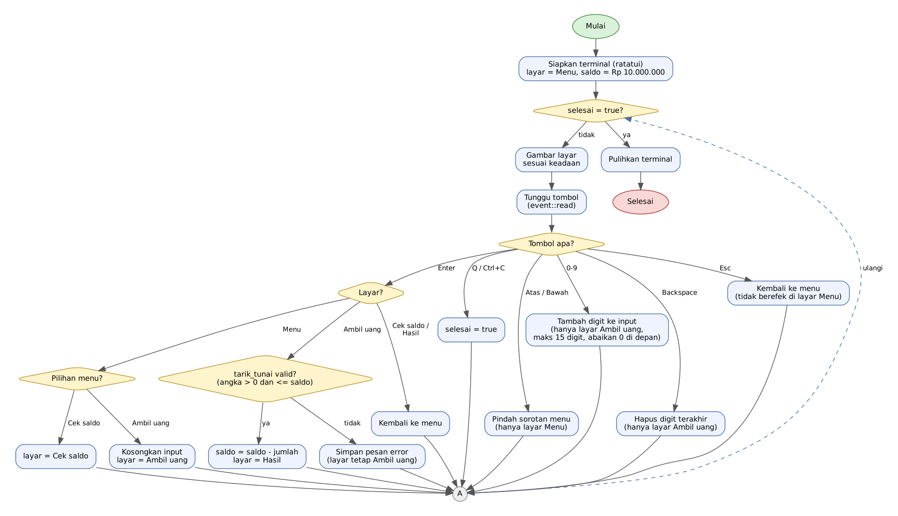
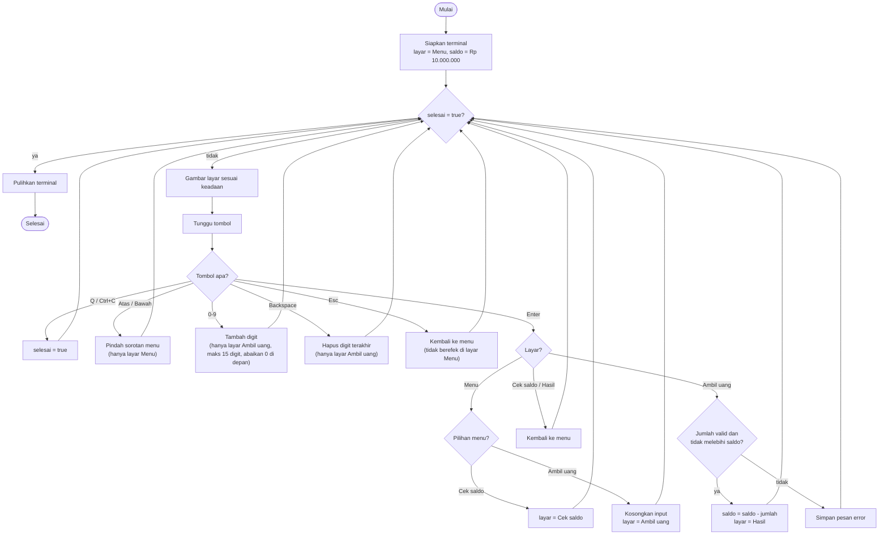

# Identitas
- **Nama**    : FIRSTO SATRIO
- **NIM**     : 26011150002
- **Prodi**   : Teknik Komputer

# ATM Bersama

Aplikasi ATM terminal **sederhana dan ringan**. Pengguna memilih transaksi dari menu
(**Cek saldo** atau **Ambil uang**), lalu mengetikkan jumlah Rupiah yang ingin diambil
(seperti `scanf` di C). **Saldo awal Rp 10.000.000.** Ditulis dengan **Rust** dan **ratatui**.

Dokumentasi lengkap dalam bentuk PDF: [`docs/26011150002_FIRSTO_SATRIO.pdf`](docs/26011150002_FIRSTO_SATRIO.pdf)

```c
/* Padanannya di C untuk membaca jumlah */
unsigned long long jumlah;
printf("Masukkan jumlah Rupiah: ");
scanf("%llu", &jumlah);
printf("Rp %llu\n", jumlah);
```

## Tampilan

> Pratinjau di bawah dirender dari tata letak pada `src/main.rs` (ukuran terminal 60×14),
> bukan tangkapan layar terminal asli.

**1. Menu utama**



**2. Cek saldo**



**3. Ambil uang: mengetik jumlah**



**4. Struk penarikan**



**5. Pesan kesalahan bila melebihi saldo**



## Fitur

- Menu sebelum memasukkan uang: Cek saldo dan Ambil uang.
- Saldo awal Rp 10.000.000 setiap aplikasi dijalankan (disimpan di memori saja).
- Membaca jumlah Rupiah dari keyboard (hanya angka, maksimal 15 digit).
- Tampilan dengan pemisah ribuan: `1500000` → `Rp 1.500.000`.
- Validasi: tidak boleh kosong, tidak boleh `Rp 0`, tidak boleh melebihi saldo, nol di depan diabaikan.
- Ringan: hanya dua dependensi langsung (`ratatui`, `crossterm`) dan profil rilis yang dioptimalkan ukuran.

## Instruksi

### 1. Prasyarat

Rust stable terbaru (edition 2024 membutuhkan minimal Rust 1.85) atau update rust yang ada (jika install dari rust langsung, bukan package manager) seperti berikut:

```bash
rustup update stable
rustc --version
```

### 2. Mengunduh dan menjalankan

```bash
git clone https://github.com/whoareu-btw/atm.git
cd atm
cargo run
```

### 3. Cara memakai

1. Pilih **Cek saldo** atau **Ambil uang** dengan tombol **Atas/Bawah**, lalu tekan **Enter**.
2. Di **Ambil uang**, ketik jumlah (misalnya `1500000`) lalu tekan **Enter**.
3. Struk tampil: jumlah yang diambil dan sisa saldo. Tekan **Enter** untuk kembali ke menu.
4. Tekan **Q** (atau **Ctrl+C**) kapan saja untuk keluar.

| Layar            | Tombol        | Fungsi                         |
|------------------|---------------|--------------------------------|
| Menu             | `Atas`/`Bawah`| Memindahkan sorotan menu       |
| Menu             | `Enter`       | Memilih transaksi              |
| Ambil uang       | `0`–`9`       | Menambah digit                 |
| Ambil uang       | `Backspace`   | Menghapus digit terakhir       |
| Ambil uang       | `Enter`       | Konfirmasi penarikan           |
| Cek saldo, Hasil | `Enter`       | Kembali ke menu                |
| Selain Menu      | `Esc`         | Kembali ke menu                |
| Semua            | `Q`, `Ctrl+C` | Keluar                         |

### 4. Build ringan (rilis)

```bash
cargo build --release
./target/release/atm
```

Profil rilis memakai `opt-level = "z"`, `lto`, `strip`, dan `panic = "abort"`
agar binary sekecil mungkin.

### 5. Menjalankan tes

```bash
cargo test
```

## Struktur proyek

```
atm/
├── Cargo.toml
├── README.md
├── docs/               # gambar, flowchart, dan 26011150002_FIRSTO_SATRIO.pdf (Dokumentasi pdf)
└── src/
    ├── main.rs         # tampilan (ratatui) dan penanganan tombol (crossterm)
    └── logika.rs       # logika murni: keadaan, validasi, penarikan, format Rupiah (+ tes)
```

Logika dipisah dari tampilan agar mudah diuji tanpa terminal.

## Flowchart



Versi teks (Mermaid, tampil otomatis di GitHub):



## Pseudocode

```text
ALGORITMA ATM_Bersama

KAMUS
    MAKS_DIGIT      = 15
    SALDO_AWAL      = 10000000
    MENU            = ["Cek saldo", "Ambil uang"]
    layar           : {Menu, CekSaldo, AmbilUang, Hasil}
    pilihan         : bilangan bulat      { 0 = Cek saldo, 1 = Ambil uang }
    saldo           : bilangan bulat
    input           : string              { hanya berisi digit 0-9 }
    jumlah_ditarik  : bilangan bulat      { kosong sampai penarikan berhasil }
    pesan_error     : string              { kosong bila tidak ada kesalahan }
    selesai         : boolean

PROSEDUR utama
    siapkan_terminal()
    layar ← Menu
    pilihan ← 0
    saldo ← SALDO_AWAL
    input ← ""
    jumlah_ditarik ← kosong
    pesan_error ← kosong
    selesai ← salah

    SELAMA tidak selesai LAKUKAN
        gambar_layar()
        tombol ← baca_tombol()
        proses_tombol(tombol)
    AKHIR SELAMA

    pulihkan_terminal()
AKHIR PROSEDUR

PROSEDUR proses_tombol(tombol)
    JIKA tombol = Q ATAU tombol = Ctrl+C MAKA
        selesai ← benar

    JIKA tombol = Atas DAN layar = Menu DAN pilihan > 0 MAKA
        pilihan ← pilihan - 1

    JIKA tombol = Bawah DAN layar = Menu DAN pilihan < 1 MAKA
        pilihan ← pilihan + 1

    JIKA tombol = angka 0-9 DAN layar = AmbilUang MAKA
        JIKA panjang(input) < MAKS_DIGIT
             DAN NOT (input kosong DAN tombol = '0') MAKA
            tambahkan tombol ke input
            pesan_error ← kosong

    JIKA tombol = Backspace DAN layar = AmbilUang MAKA
        hapus karakter terakhir dari input
        pesan_error ← kosong

    JIKA tombol = Enter MAKA
        KASUS layar
            Menu:
                JIKA pilihan = 0 MAKA
                    layar ← CekSaldo
                SELAIN ITU
                    input ← ""
                    pesan_error ← kosong
                    layar ← AmbilUang
            CekSaldo, Hasil:
                kembali_ke_menu()
            AmbilUang:
                hasil ← tarik_tunai(saldo, input)
                JIKA hasil berhasil MAKA
                    saldo ← saldo - hasil
                    jumlah_ditarik ← hasil
                    pesan_error ← kosong
                    layar ← Hasil
                SELAIN ITU
                    pesan_error ← pesan kesalahan dari hasil

    JIKA tombol = Esc DAN layar ≠ Menu MAKA
        kembali_ke_menu()
AKHIR PROSEDUR

PROSEDUR kembali_ke_menu()
    layar ← Menu
    input ← ""
    jumlah_ditarik ← kosong
    pesan_error ← kosong
AKHIR PROSEDUR

FUNGSI tarik_tunai(saldo, teks) → bilangan bulat ATAU kesalahan
    jumlah ← baca_jumlah(teks)       { padanan scanf, tetapi dengan validasi }
    JIKA jumlah kesalahan MAKA
        KEMBALIKAN kesalahan itu
    JIKA jumlah > saldo MAKA
        KEMBALIKAN kesalahan "Saldo tidak cukup"
    KEMBALIKAN jumlah
AKHIR FUNGSI

FUNGSI baca_jumlah(teks) → bilangan bulat ATAU kesalahan
    JIKA teks kosong MAKA
        KEMBALIKAN kesalahan "Jumlah belum diisi"
    JIKA ada karakter bukan digit MAKA
        KEMBALIKAN kesalahan "Hanya angka yang diperbolehkan"
    n ← ubah_ke_bilangan(teks)
    JIKA n tidak muat MAKA
        KEMBALIKAN kesalahan "Jumlah terlalu besar"
    JIKA n = 0 MAKA
        KEMBALIKAN kesalahan "Jumlah harus lebih dari Rp 0"
    KEMBALIKAN n
AKHIR FUNGSI

FUNGSI format_rupiah(n) → string
    digit ← n sebagai teks
    sisipkan "." setiap 3 digit dari kanan
    KEMBALIKAN "Rp " + digit
AKHIR FUNGSI
```

## Perbaikan bug dari versi sebelumnya

| # | Masalah pada kode lama | Perbaikan |
|---|------------------------|-----------|
| 1 | `use ratatui::sytle::stylize` (salah ketik) | `ratatui::style::Stylize` |
| 2 | `io::result` | `io::Result` |
| 3 | `"<Esc>".blue().bold,` kurang tanda kurung | `.bold()` |
| 4 | Variabel `instructions` tidak ada (yang dibuat bernama `title`) | Dibuat `petunjuk` dan dipakai di `title_bottom` |
| 5 | `border::THICK` dipakai tanpa `use ratatui::symbols::border` | Ditambahkan import |
| 6 | `exit`, `selanjutnya`, `sebelumnya` ada di dalam `impl Widget for &App`, padahal bukan anggota trait `Widget` | Dipindah ke `impl Keadaan` di `logika.rs` |
| 7 | `self.enter` dan `self.escape` tidak pernah dideklarasikan; field `counter` tidak terpakai | Diganti struct `Keadaan` yang jelas |
| 8 | Tes: `counter_style` tidak ada, `assert_ew!` salah ketik, `assert_eq!(app.selanjutnya, enter)` membandingkan method dengan identifier yang tidak ada | Tes ditulis ulang dan diperluas |
| 9 | Tes: buffer 50×4 tetapi hasil yang diharapkan 6 baris | Memeriksa isi teks layar |
| 10 | Fitur utama belum ada: menu hanya label tanpa input jumlah, dan tidak ada saldo | Menu Cek saldo / Ambil uang, saldo awal Rp 10.000.000, dan input jumlah Rupiah |

## Catatan
Kode yang ada di branch `main`, README, docs  dibantu oleh Claude AI. Untuk kode yang belum dibantu oleh Claude AI ada di branch `legacy`.
Tambahan, beberapa dokumentasi terhadap warna yang digunakan sudah diubah beberapa warna:
- Hijau jadi putih pada `cek saldo`
- Hijau jadi biru pada `ambil uang`
- Dan kuning jadi putih pada pemilihan menu

## Terima Kasih
Terima kasih pada:
- Pak Kikim Mukiman, S.Kom., M.Kom.
- Dokumentasi ratatui: https://ratatui.rs/tutorials/counter-app/basic-app/
- Claude AI
